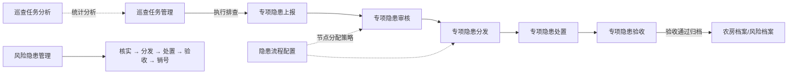

# 农村自建房 — 风险巡查管理 & 预警中心 页面明细

> 整理日期：2026-11-03
> 范围：农村自建房模块下的「风险巡查管理」（3 个菜单）与「预警中心」（7 个菜单），共 10 个菜单入口、20+ 个页面。

---

## 一、风险巡查管理

| 菜单 / 层级 | 页面文件 | 功能明细 |
|---|---|---|
| 巡查任务管理 | `pages/patrol-task-management.html` | 5 个 Tab：**全部 / 日常巡查 / 专项巡查 / 临时巡查 / 隐患复查**；任务列表字段：任务名称、类型、镇/街道/行政村、排查员、上报进度、发现隐患、任务状态、截止时间、操作 |
| ├ 新增任务 | `pages/rural-risk-task-add.html` | 创建巡查任务（任务类型、排查范围、排查人员、周期计划） |
| ├ 任务调整 | `pages/rural-risk-task-adjust.html` | 调整已下发任务的周期、人员、范围 |
| ├ 任务分配 | `pages/rural-risk-task-allocation.html` | 将任务分派到具体排查员 |
| └ 任务详情 | `pages/rural-risk-task-detail.html` | 任务执行进度、覆盖房屋清单、逐栋上报记录 |
| 巡查任务配置 | `pages/patrol-task-config.html` | 巡查配置管理：按配置名称查询，维护巡查类型 / 周期 / 检查项配置表，支持新增与编辑配置 |
| 巡查任务分析 | `pages/patrol-task-analysis.html` | ECharts 统计分析（风险等级构成等图表）+ 时间轴播放回放巡查动态；弹窗可跳转任务详情 |

---

## 二、预警中心

### 1. 风险隐患管理（日常隐患全流程）

| 页面 | 文件 | 功能明细 |
|---|---|---|
| 隐患管理列表 | `pages/rural-warning-management.html` | 6 个 Tab：**全部 / 待核实 / 待分发 / 处置中 / 待验收 / 已销号**；含「隐患登记」入口；列表字段：风险部位、风险类型、风险等级、风险描述、现场照片（检查记录）等；按状态跳转不同操作页 |
| 隐患核实 | `pages/rural-warning-audit.html` | 「待核实」状态的核实操作页 |
| 隐患分发 | `pages/rural-warning-dispatch.html` | 「待分发」状态的分派处置人页 |
| 处置详情 | `pages/rural-warning-handle.html` | 「处置中 / 待验收」查看与填报；**处置过程 4 块：安全鉴定 / 安全评估 / 整治计划 / 整治措施**；含状态流转时间线、现场照片（仅保留巡查照片） |
| 验收详情 | `pages/rural-warning-acceptance.html` | 「待验收」确认与验收记录；同 4 块处置过程展示 |
| 隐患查看 | `pages/rural-warning-detail.html` | 「全部 / 已销号」状态的只读查看页 |

**列表状态跳转规则**：

| 状态 Tab | 操作按钮跳转 |
|---|---|
| 待核实 | `rural-warning-audit.html`（核实） |
| 待分发 | `rural-warning-dispatch.html`（分发） |
| 处置中 | `rural-warning-handle.html`（处置填报/查看） |
| 待验收 | `rural-warning-acceptance.html`（验收/查看） |
| 全部 / 已销号 | `rural-warning-detail.html`（查看） |

### 2. 专项隐患五步流转链

| 菜单 | 列表页 | Tab 页签 | 详情页 |
|---|---|---|---|
| 专项隐患上报 | `pages/rural-hazard-report-list.html` | 全部 / 进行中 / 待审核 / 已完成 | → `rural-risk-task-detail.html?from=report`（专项排查任务上报） |
| 专项隐患审核 | `pages/rural-hazard-audit-list.html` | 待审核 / 已通过 / 已退回 / 全部 | `pages/rural-hazard-audit-detail.html` |
| 专项隐患分发 | `pages/rural-hazard-dispatch-list.html` | 待分发 / 已下发 / 全部 | `pages/rural-hazard-dispatch-detail.html` |
| 专项隐患处置 | `pages/rural-hazard-handle-list.html` | 全部 / 待接收 / 处置中 / 待验收 / 已完成 | `pages/rural-hazard-handle-detail.html` — 处置填报四环节：安全鉴定 / 安全评估 / 整治计划 / 整治措施，**全部视情填写、无必填项**；仅代报时必填代报人 |
| 专项隐患验收 | `pages/rural-hazard-acceptance-list.html` | 待验收 / 已验收 | `pages/rural-hazard-acceptance-detail.html` — 验收照片 ≥1 张；验收通过后自动更新房屋风险等级并归档，退回则返回重新处置 |

**专项隐患处置填报四环节字段**（与农房档案字段保持一致，最终推送至农房档案）：

| 环节 | 主要内容 |
|---|---|
| 安全鉴定 | 鉴定结论、鉴定机构、鉴定报告（附件）、鉴定日期 |
| 安全评估 | 评估结论、评估机构、评估报告（附件）、评估日期 |
| 整治计划 | 整治类型、计划完成时限、计划内容 |
| 整治措施 | 管理措施（实施照片、完成照片）/ 工程措施（实施照片、完成照片）、措施是否完成 |

### 3. 隐患流程配置

| 页面 | 功能明细 |
|---|---|
| `pages/rural-flow-config.html` | 按 **4 种隐患来源**分别配置流程节点策略：排查发现 / 巡查人员上报 / 群众举报 / 专家研判；每种来源配置 **6 个节点**（上报 → 审核 → 分发 → 接收 → 处置 → 验收）的分配策略与默认角色，支持自动审核、自动分发、退回策略（退回上一节点 / 退回初始上报人） |

**分配策略选项**：按系统角色分配 / 按房屋属地（街镇/村）分配 / 按隐患上报人分配 / 按第三方鉴定机构分配。

**默认角色池**：巡查人员、街镇城建中心管理员、区级管理员、村级网格员、产权人、第三方鉴定机构、专家。

---

## 三、整体流转关系

## 四、数据存储说明

| 数据 | 存储位置 |
|---|---|
| 专项隐患分发包（含子任务状态、处置报告、验收记录） | `localStorage.hazardDispatchPackages[taskId]` |
| 巡查/排查任务 | `localStorage.patrolTasks` |
| 风险隐患（日常） | 页面内置数据 + `localStorage` 覆盖 |
| 种子脚本 | `pages/rural-audit-seed.js`（`ensureAuditSeedTasks()` 幂等补种子任务） |
